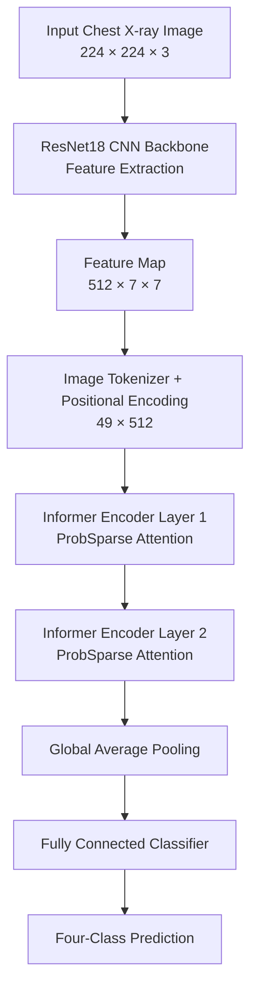
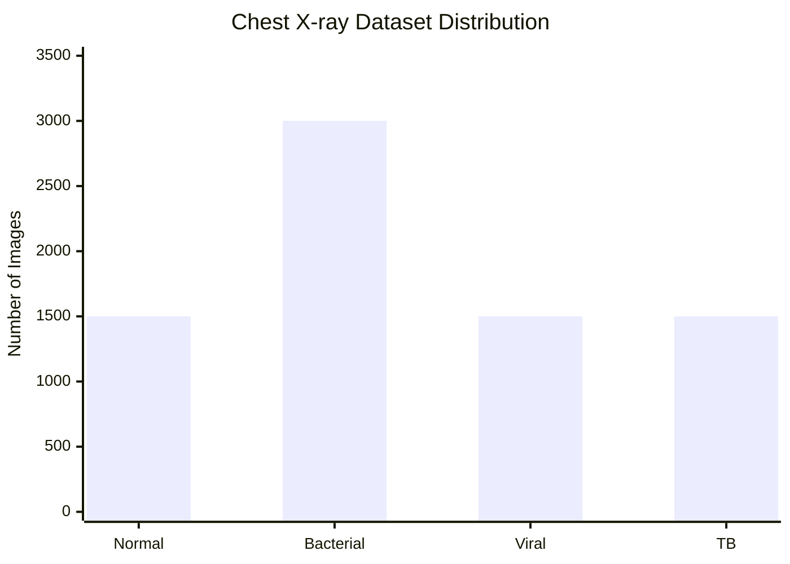

# Android-Chest-Xray-Informer-Copy
Android-Based Deep Learning System for Pneumonia and Tuberculosis Detection Using Chest X-ray Images.
# 🩻 Android-Based Chest X-ray Informer
### Deep Learning-Based Detection of Pneumonia and Tuberculosis Using Chest X-ray Images

A B.Tech final-year project that combines **ResNet18 CNN and an Informer-style Transformer** to classify chest X-ray images into four categories. The trained model is also prepared for deployment in an Android application.

---

## 📌 About the Project

Pneumonia and Tuberculosis are serious respiratory diseases that require timely diagnosis.

This project explores a deep learning approach for analyzing chest X-ray images using a hybrid CNN-Transformer architecture.

ResNet18 extracts important visual features, while the Informer-style Transformer learns relationships between extracted image features to perform four-class classification.

The project includes model development, training, evaluation, and Android-based deployment.

## 🎯 Project Objectives

- Develop a hybrid ResNet18 + Informer Transformer architecture.
- Classify chest X-ray images into four categories.
- Perform image preprocessing and feature extraction.
- Evaluate the model using accuracy, precision, recall, F1-score and confusion matrix.
- Prepare the trained model for mobile deployment.

## 🧠 Model Architecture

**Hybrid Architecture: ResNet18 + Informer Transformer**

The model consists of the following stages:

1. **Input Image:** Chest X-ray image resized to 224 × 224 pixels.
2. **ResNet18 Backbone:** Extracts deep visual features from the X-ray image.
3. **Image Tokenizer:** Converts the 7 × 7 feature map into 49 tokens.
4. **Positional Encoding:** Adds positional information to the feature tokens.
5. **Informer Encoder:** Uses ProbSparse Attention to learn relationships between image tokens.
6. **Feature Distillation:** Uses convolution and max pooling to reduce sequence length.
7. **Classification Head:** Performs final four-class classification.

### Architecture Diagram



### Model Configuration

| Parameter | Configuration |
|---|---|
| CNN Backbone | ResNet18 |
| Pretrained Weights | ImageNet |
| Embedding Dimension | 512 |
| Attention Heads | 8 |
| Informer Encoder Layers | 2 |
| Feed Forward Dimension | 1024 |
| Attention Mechanism | ProbSparse Attention |
| Dropout | 0.1 |
| Total Parameters | 17,116,484 |
| Number of Classes | 4 |

## 📂 Dataset Information

The dataset contains 7,501 chest X-ray images distributed across four classes.

| Class | Number of Images |
|---|---:|
| Normal | 1,500 |
| Pneumonia Bacterial | 3,001 |
| Pneumonia Viral | 1,500 |
| Tuberculosis | 1,500 |
| **Total** | **7,501** |

### Dataset Distribution



### Dataset Split

- Training: 70% (5,250 images)
- Validation: 15% (1,125 images)
- Testing: 15% (1,126 images)

Random seed: 42

## ⚙️ Image Preprocessing

The notebook uses the following preprocessing steps:

- Image resizing to 224 × 224.
- RGB image conversion for model input.
- Tensor conversion.
- ImageNet normalization.

Normalization parameters:

- Mean: [0.485, 0.456, 0.406]
- Standard Deviation: [0.229, 0.224, 0.225]

## 🏋️ Model Training

The model was trained using:

- Framework: PyTorch
- Loss Function: Weighted Cross Entropy Loss
- Optimizer: Adam
- Learning Rate: 0.0001
- Learning Rate Scheduler: ReduceLROnPlateau
- Maximum Epochs: 30
- Early Stopping and Model Checkpointing

The best model checkpoint was selected based on validation loss.

## 📊 Model Evaluation

The model is evaluated using:

- Overall Accuracy
- Precision
- Recall
- F1-Score
- Confusion Matrix

Detailed evaluation results and final verified test accuracy will be added after confirming the consistent evaluation output.

## 📱 Android Deployment

The trained deep learning model was exported in TorchScript `.ptl` format for mobile deployment.

Android integration includes:

- Chest X-ray image selection.
- Image preprocessing.
- Model loading and inference.
- Four-class prediction display.

The exported model size recorded in the notebook is approximately 65.59 MB.

## 🛠️ Technologies Used

| Category | Technologies |
|---|---|
| Programming | Python, Java |
| Deep Learning | PyTorch |
| CNN Architecture | ResNet18 |
| Transformer | Informer-style Transformer |
| Data Processing | NumPy, Pandas |
| Visualization | Matplotlib, Seaborn |
| Evaluation | Scikit-learn |
| Development | Google Colab, Android Studio |
| Version Control | Git, GitHub |

## 📁 Project Structure

```text
Android-Chest-Xray-Informer/
│
├── README.md
│
├── Colab-Notebook/
│   └── Chest_Xray_Informer_Project.ipynb
│
├── Android-App/
│   └── Android Studio source code
│
├── Results/
│   ├── confusion_matrix.png
│   ├── classification_report.csv
│   ├── class_distribution.png
│   ├── training_accuracy.png
│   └── training_loss.png
│
└── Screenshots/
    ├── app_home.png
    └── prediction_result.png
```

## 🚀 Future Enhancements

- Improve classification performance, particularly for challenging classes.
- Optimize the model size for mobile devices.
- Improve Android application usability.
- Explore explainable AI techniques for model interpretation.
- Perform further validation on independent datasets.

## ⚠️ Disclaimer

This project is developed for academic and research purposes. It is not a clinically validated diagnostic system and should not be used as a substitute for professional medical diagnosis.

## 👩‍💻 Academic Project

**Degree:** B.Tech – Computer Science and Engineering

**Institution:** Government College of Engineering, Keonjhar, Odisha

**Project Title:** Development of Android-Based Embedded Deep Neural Network for Detection of Pneumonia and Tuberculosis Using Chest X-ray Images.

---

⭐ If you find this project interesting, feel free to explore the repository and share your feedback.

**Learning, experimenting, and building with Deep Learning!**
