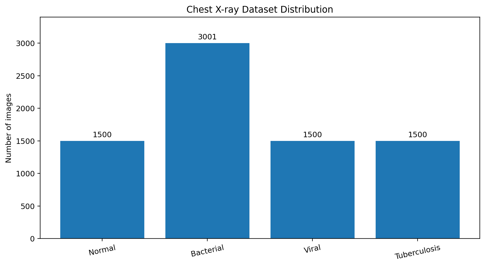
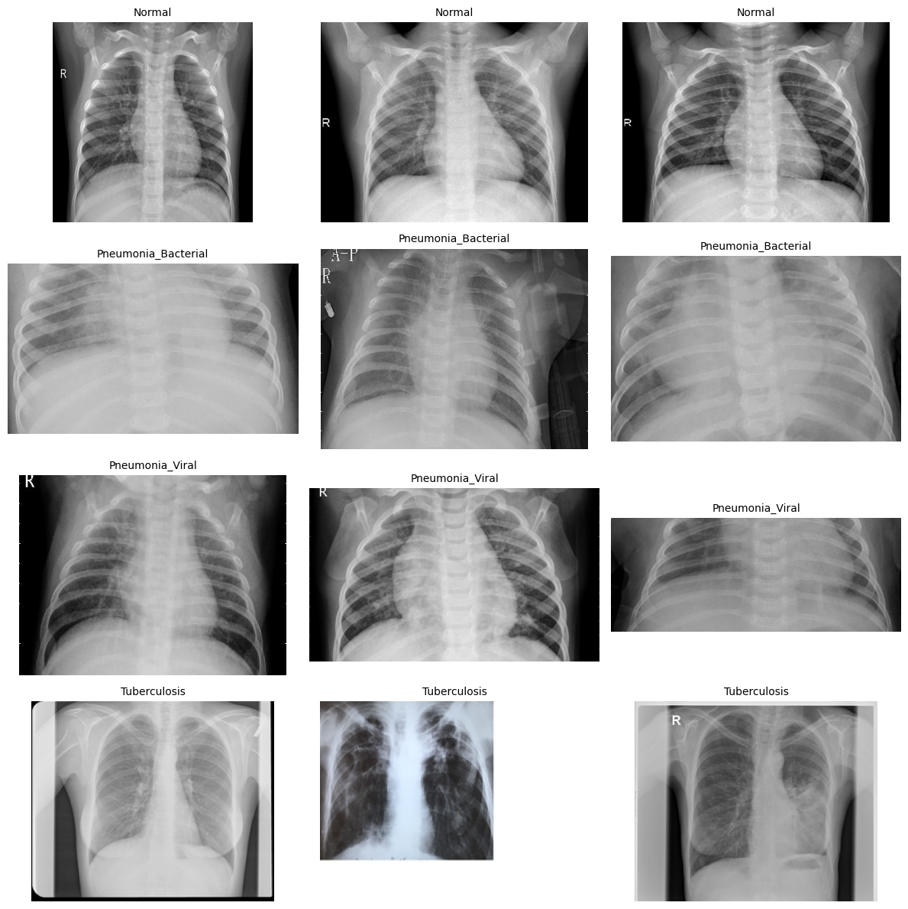
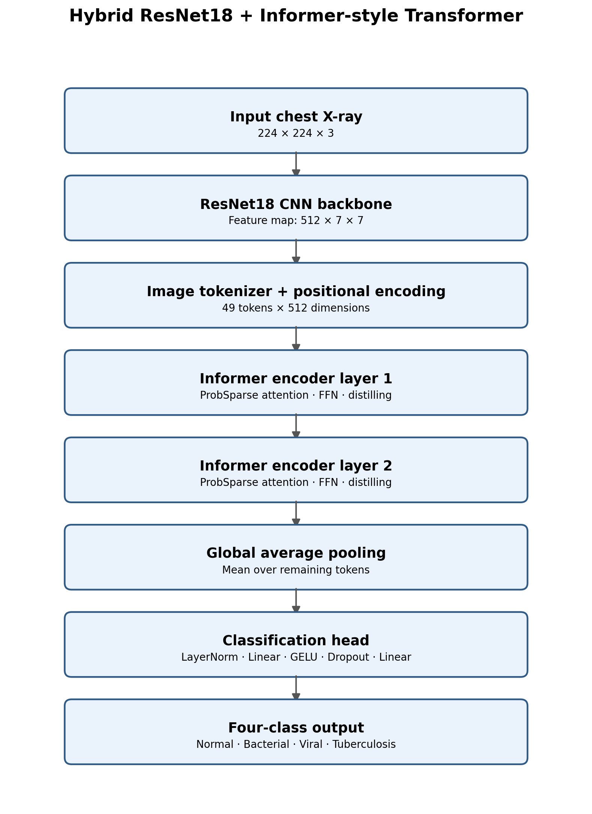
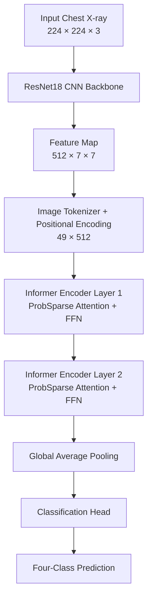
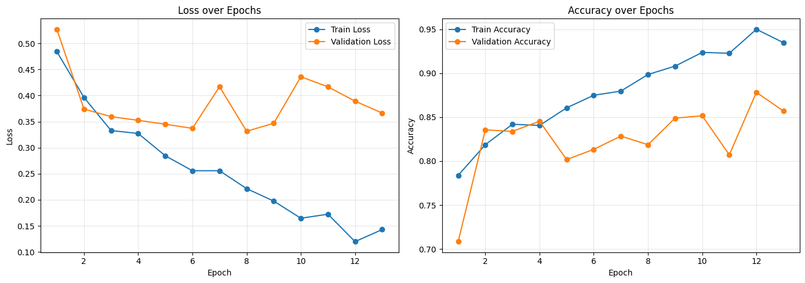
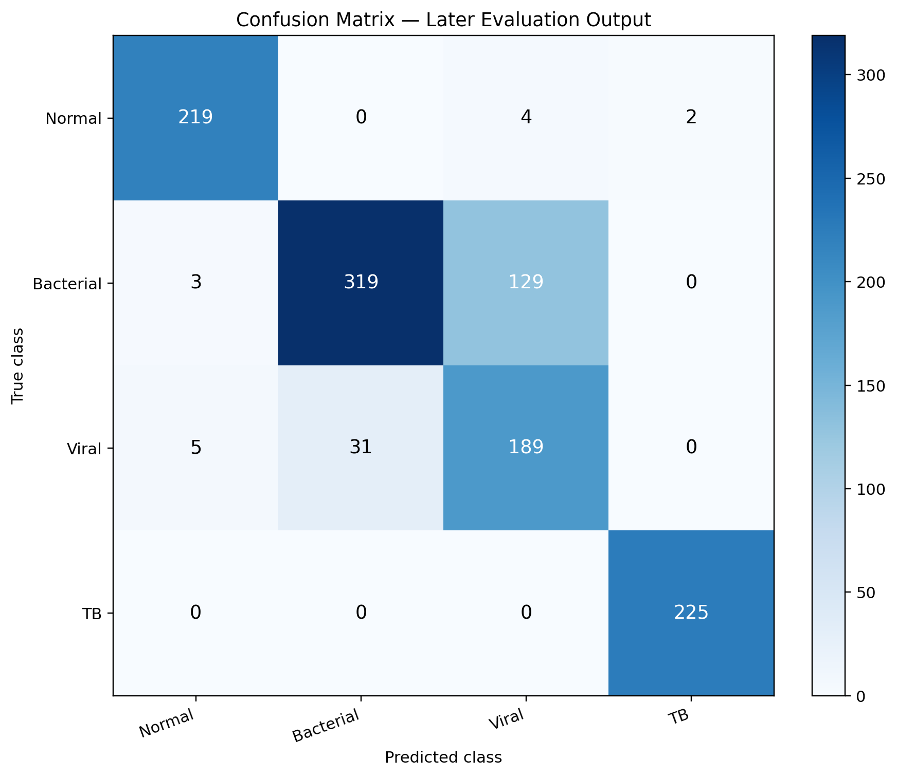

# 🩻 Android-Based Chest X-ray Informer

### Development of Android-Based Embedded Deep Neural Network for Detection of Pneumonia and Tuberculosis Using Chest X-ray Images

A B.Tech final-year academic project that uses a hybrid **ResNet18 CNN + Informer Transformer** architecture to classify chest X-ray images into four categories. The trained deep learning model is prepared for integration into an Android application using TorchScript Mobile (`.ptl`).

> **Research Disclaimer:** This project is developed for academic and educational purposes only. It is not a clinically validated diagnostic system and must not be used as a substitute for professional medical diagnosis.

---

## 📌 Project Overview

Pneumonia and Tuberculosis (TB) are respiratory diseases that can produce abnormalities visible in chest X-ray images.

This project aims to develop an Android-based embedded deep learning system that analyzes chest X-ray images and classifies them into four categories using a hybrid CNN–Transformer architecture.

The proposed model combines:

- **ResNet18:** Extracts spatial and visual features from chest X-ray images.
- **Informer Transformer:** Models relationships between extracted image features using ProbSparse attention.
- **Classification Head:** Produces predictions for four categories.
- **Android Application:** Provides an interface for selecting X-ray images and displaying model predictions.

### 🎯 Project Objectives

- Develop a hybrid ResNet18 + Informer deep learning architecture.
- Classify chest X-ray images into four categories.
- Train and evaluate the model using training, validation and testing datasets.
- Analyze performance using accuracy, precision, recall, F1-score and confusion matrix.
- Convert the trained model into TorchScript Mobile (`.ptl`) format.
- Integrate the embedded model into an Android application for on-device inference.

---

## 🩻 Dataset Description

The project uses a dataset containing **7,501 chest X-ray images** distributed across four classes.

| Class | Number of Images |
|---|---:|
| Normal | 1,500 |
| Pneumonia Bacterial | 3,001 |
| Pneumonia Viral | 1,500 |
| Tuberculosis | 1,500 |
| **Total** | **7,501** |

### Dataset Distribution



### Dataset Samples

The following image displays sample chest X-ray images used in the project.



### Dataset Split

The dataset is divided into three subsets:

| Dataset | Images | Percentage |
|---|---:|---:|
| Training | 5,250 | 70% |
| Validation | 1,125 | 15% |
| Testing | 1,126 | 15% |
| **Total** | **7,501** | **100%** |

The notebook uses random seed `42`.

### Per-Class Dataset Split

| Class | Training | Validation | Testing |
|---|---:|---:|---:|
| Normal | 1,050 | 225 | 225 |
| Pneumonia Bacterial | 2,100 | 450 | 451 |
| Pneumonia Viral | 1,050 | 225 | 225 |
| Tuberculosis | 1,050 | 225 | 225 |

---

## 🧠 Proposed Model Architecture

### Hybrid ResNet18 + Informer Transformer

The proposed architecture combines a Convolutional Neural Network (CNN) with a Transformer-based feature modelling approach.



### Architecture Workflow



### Main Components

**1. ResNet18 Backbone**

ResNet18 is used as the CNN feature extractor. It extracts visual information from chest X-ray images using convolutional layers and residual connections.

**2. Image Tokenizer**

The extracted feature map of size `512 × 7 × 7` is converted into a sequence of 49 tokens, each containing 512 features.

**3. Positional Encoding**

Learned positional information is added to the image tokens to preserve spatial relationships.

**4. ProbSparse Attention**

The custom Informer attention module selects informative queries for attention computation, reducing unnecessary attention operations.

**5. Informer Encoder Layers**

Two Informer encoder layers process the feature sequence using attention, residual connections, normalization, feed-forward networks and sequence distilling.

**6. Classification Head**

Global average pooling is followed by LayerNorm, Linear, GELU, Dropout and a final Linear layer to generate four-class predictions.

### Model Configuration

| Parameter | Configuration |
|---|---|
| CNN Backbone | ResNet18 |
| Pretrained Weights | ImageNet |
| Input Image Size | 224 × 224 × 3 |
| Feature Map | 512 × 7 × 7 |
| Token Sequence | 49 × 512 |
| Embedding Dimension | 512 |
| Attention Heads | 8 |
| Informer Encoder Layers | 2 |
| Feed-Forward Dimension | 1,024 |
| ProbSparse Sample Factor | 5 |
| Dropout | 0.1 |
| Trainable Parameters | 17,116,484 |
| Output Classes | 4 |

---

## ⚙️ Image Preprocessing

Before feeding images into the deep learning model, preprocessing is performed.

The notebook's evaluation pipeline includes:

1. Opening the chest X-ray image.
2. Converting the image into RGB format.
3. Resizing the image to 224 × 224 pixels.
4. Converting the image into a PyTorch tensor.
5. Applying ImageNet normalization.

### Normalization Parameters

**Mean:**

`[0.485, 0.456, 0.406]`

**Standard Deviation:**

`[0.229, 0.224, 0.225]`

Training transforms also include mild data augmentation, whereas validation and testing transforms do not use augmentation.

---

## 🏋️ Training Configuration

The model is developed and trained using the PyTorch deep learning framework.

| Parameter | Value |
|---|---|
| Framework | PyTorch |
| Loss Function | Class-weighted Cross Entropy |
| Optimizer | Adam |
| Learning Rate | 0.0001 |
| Scheduler | ReduceLROnPlateau |
| Scheduler Factor | 0.5 |
| Scheduler Patience | 2 |
| Maximum Epochs | 30 |
| Early Stopping Patience | 5 |
| Batch Size | 32 |
| Random Seed | 42 |

### Training and Validation Results

The following figure displays the training and validation accuracy and loss curves exported from the project notebook.



**Training Observation:**

- The displayed training log shows early stopping at epoch 13.
- The lowest validation loss in that log is 0.3315 at epoch 8.
- The notebook contains a different checkpoint summary elsewhere. The training run and checkpoint should be reconciled before reporting final results.

---

## 📊 Model Evaluation

The model is evaluated using the following performance metrics:

- Accuracy
- Precision
- Recall
- F1-score
- Confusion Matrix

### Reported Test Accuracy

The notebook contains two evaluation outputs:

- Earlier evaluation: 83.57%
- Later evaluation: 84.55%

These values are not fully consistent across the notebook. Therefore, they are provisional and should be verified by rerunning evaluation using one saved checkpoint and the same test predictions.

### Later Classification Report

| Class | Precision | Recall | F1-score | Support |
|---|---:|---:|---:|---:|
| Normal | 0.965 | 0.973 | 0.969 | 225 |
| Pneumonia Bacterial | 0.911 | 0.707 | 0.797 | 451 |
| Pneumonia Viral | 0.587 | 0.840 | 0.691 | 225 |
| Tuberculosis | 0.991 | 1.000 | 0.996 | 225 |
| Macro Average | 0.864 | 0.880 | 0.863 | 1,126 |
| Weighted Average | 0.873 | 0.845 | 0.850 | 1,126 |

### Confusion Matrix

The following matrix represents the later labeled confusion-matrix output recorded in the notebook.



### Confusion Matrix Values

Rows represent actual classes, and columns represent predicted classes.

| Actual / Predicted | Normal | Bacterial | Viral | Tuberculosis |
|---|---:|---:|---:|---:|
| Normal | 219 | 0 | 4 | 2 |
| Pneumonia Bacterial | 3 | 319 | 129 | 0 |
| Pneumonia Viral | 5 | 31 | 189 | 0 |
| Tuberculosis | 0 | 0 | 0 | 225 |

**Evaluation Note:** The notebook contains multiple evaluation outputs that do not completely agree. The classification report, confusion matrix and accuracy must be regenerated together before these results are treated as final verified metrics.

---

## 📱 Android Deployment and TorchScript

After model training, the trained network is exported into TorchScript Mobile (`.ptl`) format for Android integration.

### Recorded Export Details

| Parameter | Value |
|---|---|
| Model Format | TorchScript Mobile |
| File Extension | `.ptl` |
| Model File | `chest_xray_informer_final.ptl` |
| Approximate Model Size | 65.59 MB |
| Inference Device for Timing | Google Colab CPU |

The exported model is loaded on CPU for mobile-style inference testing. The notebook also checks prediction agreement between the original and traced models.

### CPU Inference Timing

| Measurement | Result |
|---|---:|
| Number of Runs | 20 |
| Average Latency | 93.356 ms |
| Median Latency | 96.904 ms |
| Minimum Latency | 61.257 ms |
| Maximum Latency | 119.640 ms |

**Note:** These timings were recorded on the Google Colab CPU. Preprocessing and image-selection time were excluded. They should not be interpreted as Android-device benchmark results.

### Android Application Workflow

1. Open the Android application.
2. Select a chest X-ray image.
3. Validate and preprocess the selected image.
4. Load the embedded `.ptl` model.
5. Perform local model inference.
6. Display the predicted class and confidence score.

---

## 🛠️ Technologies and Tools Used

| Category | Technologies |
|---|---|
| Programming Language | Python, Java |
| Deep Learning | PyTorch |
| CNN Architecture | ResNet18 |
| Transformer Architecture | Informer |
| Attention Mechanism | ProbSparse Attention |
| Data Processing | NumPy, Pandas |
| Visualization | Matplotlib, Seaborn |
| Model Evaluation | Scikit-learn |
| Model Deployment | TorchScript Mobile |
| Development Environment | Google Colab |
| Android Development | Android Studio |

---

## 📁 Project Structure

```text
Android-Chest-Xray-Informer-Copy/
│
├── README.md
│
├── Chest_Xray_Informer_Project.ipynb
│
├── assets/
│   ├── dataset_samples.png
│   ├── class_distribution.png
│   ├── model_architecture.png
│   ├── training_curves.png
│   └── confusion_matrix.png
│
└── .gitignore
```

---

## 🚀 Future Improvements

- Re-run the final model evaluation and reconcile the recorded metrics.
- Validate the model using an independent test dataset.
- Improve classification performance for Pneumonia Viral images.
- Complete and document Android application integration.
- Evaluate model inference speed and memory usage on a physical Android device.
- Explore explainability techniques for better model interpretation.

---

## ⚠️ Disclaimer

This project is intended strictly for academic and educational purposes.

The developed model is an experimental research prototype and has not been clinically validated. It must not be used for real-world medical diagnosis or treatment decisions.

Always consult qualified healthcare professionals for medical interpretation of chest X-ray images.

---

## 👩‍💻 Academic Project Information

**Degree:** B.Tech – Computer Science and Engineering

**Institution:** Government College of Engineering, Keonjhar, Odisha

**University:** BPUT

**Project Title:** Development of Android-Based Embedded Deep Neural Network for Detection of Pneumonia and Tuberculosis Using Chest X-ray Images.

**Model Architecture:** ResNet18 + Informer Transformer

**Project Type:** B.Tech Final-Year Academic Project

---

⭐ If you find this project interesting, feel free to explore the repository and share your feedback!

**Thank you for visiting my project!**
